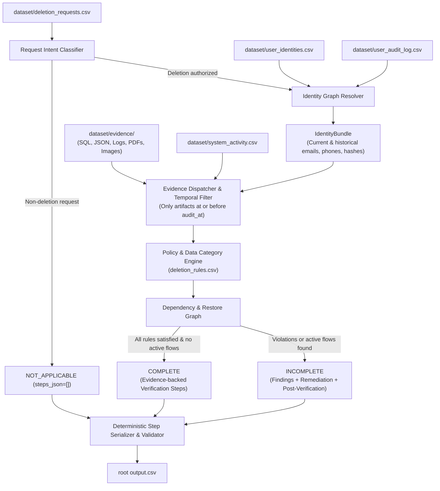

# Ghost Data Still Exists: AI Deletion-Audit Agent

[](https://www.hackerrank.com/contests/hackerrank-orchestrate-october26/challenges/ghost-data-still-exists)
[](https://www.python.org/)

An automated, evidence-grounded AI deletion audit system built for the **HackerRank Orchestrate (October 2026)** benchmark challenge: **Ghost Data Still Exists**.

---

## 1. Problem Overview

In modern multi-service commerce architectures, a deletion workflow may report a privacy request as **"Complete"** while personal data remains across secondary replicas, support attachments, object stores, search indexes, analytics cohorts, logs, and backups. In worst-case scenarios, active replication, data synchronization jobs, or database restores can actively resurrect deleted records as "ghosts."

This audit agent systematically inspects subject privacy requests, determines true request intent, resolves historical identity mutations, audits evidence across distributed systems at point-in-time cutoffs (`audit_at`), applies governance rules (`deletion_rules.csv`), and emits an evidence-backed verification and remediation sequence.

---

## 2. Architecture & Design

The solution follows a **deterministic core with temporal and identity graph reasoning** to guarantee speed, auditability, reproducibility, and zero hallucinated operations.



### Core Pipeline Components
1. **Request Intent Classifier (`code/reasoning/request_classifier.py`)**:
   - Parses multilingual requests to distinguish true account/data deletion from subject access, information requests, billing copies, marketing opt-outs, or mobile/email updates.
   - Non-deletion requests safely evaluate to `NOT_APPLICABLE` with `steps_json = []`.
2. **Identity Graph Resolver (`code/identity/resolver.py`)**:
   - Reconstructs complete identity histories (current snapshot + historical audit log mutations) for each subject valid up to `audit_at`.
   - Recovers previous email addresses, phone numbers, full names, and email hashes.
3. **Evidence Dispatcher & Extraction (`code/evidence/`)**:
   - Indexes and normalizes 94 evidence artifacts across SQL snapshots, JSON data bundles, application logs, text handover notes, and PDF attachments.
   - Enforces temporal isolation: artifacts captured strictly after `audit_at` are ignored.
4. **Policy Engine (`code/reasoning/policy_engine.py`)**:
   - Evaluates records against `deletion_rules.csv` across categories: `USER_PROFILE`, `SECONDARY_IDENTIFIER`, `SEARCH_INDEX_ENTRY`, `SUPPORT_MESSAGE`, `SUPPORT_ATTACHMENT`, `ANALYTICS_PROFILE`, `SECURITY_AUDIT_LOG`, `ACCOUNT_TOMBSTONE`, etc.
   - Enforces proper treatment: `DELETE`, `REDACT`, `ANONYMIZE`, or `RETAIN`.
5. **Dependency & Restore Graph (`code/reasoning/dependency_graph.py`)**:
   - Traces active synchronization connectors (`REPORT_ACTIVE_DATA_FLOW`) and restore paths (`REPORT_RESTORE_RISK`).
   - Sequences remediation safely: disables active flows and blocks restores before modifying records.
6. **Strict Serializer & Contract Validator (`code/output/`)**:
   - Formats outputs to exact challenge specification, validating step numbers (1..N), allowed operations, and canonical phase ordering.

---

## 3. Directory Layout

```text
├── AGENTS.md                                # Official instructions and turn logging requirements
├── ANTIGRAVITY_IMPLEMENTATION_PLAN.md       # Comprehensive 1,360+ line engineering blueprint
├── README.md                                # Project documentation and execution guide
├── log.txt                                  # Append-only session transcript (for submission)
├── output.csv                               # Generated benchmark predictions (518 cases)
├── dataset/                                 # Challenge dataset and evidence files
│   ├── deletion_requests.csv                # 518 evaluation cases to predict
│   ├── sample_deletion_requests.csv         # 32 public sample cases
│   ├── sample_output.csv                    # Ground-truth sample answers
│   ├── user_identities.csv                  # Current user identities snapshot
│   ├── user_audit_log.csv                   # Historical identity change events
│   ├── system_activity.csv                  # System operations and data flows
│   ├── deletion_rules.csv                   # 15 data category governance rules
│   ├── evidence_files.csv                   # Manifest indexing 94 evidence files
│   └── evidence/                            # Databases, documents, images, logs, records
└── code/
    ├── main.py                              # Main execution entry point
    ├── config.py                            # Path constants and allowed operation enums
    ├── schemas.py                           # Strongly-typed dataclasses
    ├── ingestion/                           # CSV loaders and manifest parsers
    ├── identity/                            # Identity history & resolver engine
    ├── evidence/                            # Multi-format parsers (SQL, JSON, logs, PDF)
    ├── reasoning/                           # Request intent, policy, and remediation planner
    ├── output/                              # Serializer and schema contract validator
    └── evaluation/                          # Evaluation and usage reporting
        ├── main.py                          # Evaluation harness
        ├── evaluation_report.md             # Accuracy metrics and custom test cases
        └── usage_report.md                  # Token usage and cost accounting
```

---

## 4. Quick Start & Execution

### Prerequisites
- Python 3.10+ (Standard library modules `sqlite3`, `csv`, `json`, `pathlib`, `re`, `datetime` are utilized; zero heavy external dependencies required for core execution).

### 1. Run Predictions
To run the deletion-audit pipeline and generate `output.csv` at the repository root:
```bash
python code/main.py
```
This reads `dataset/deletion_requests.csv` and outputs exactly 518 ordered rows into `output.csv`.

### 2. Run Sample Evaluation
To evaluate pipeline predictions against the public sample cases (`dataset/sample_output.csv`):
```bash
python code/evaluation/main.py --mode samples
```

### 3. Validate Generated Output
To run strict contract validation on `output.csv`:
```bash
python code/main.py --validate-only
```

---

## 5. Benchmark Output Contract

The generated root `output.csv` conforms strictly to the challenge schema:

```text
case_id,deletion_status,steps_json
```

| Field | Allowed Values / Format | Description |
|---|---|---|
| `case_id` | `case_XX` (lexicographically sorted) | Unique identifier for each evaluated request. |
| `deletion_status` | `COMPLETE`, `INCOMPLETE`, `NOT_APPLICABLE` | Audit verdict at the `audit_at` cutoff. |
| `steps_json` | JSON Array of objects (or `[]` for `NOT_APPLICABLE`) | Ordered sequence of findings, remediation, and verification. |

### Step Schema
```json
{
  "step_no": 1,
  "phase": "FINDING",
  "system_id": "account_service",
  "resource_id": "account_005",
  "operation": "REPORT_REMAINING_RECORD",
  "state": "PRESENT",
  "evidence_id": "evidence_54"
}
```

### Canonical Ordering Rules
1. **Phases**: `FINDING` &rarr; `REMEDIATION` &rarr; `VERIFICATION`.
2. **Operations**:
   - **Findings**: `REPORT_REMAINING_RECORD` &rarr; `REPORT_EXPOSED_PII` &rarr; `REPORT_ACTIVE_DATA_FLOW` &rarr; `REPORT_RESTORE_RISK`
   - **Remediation**: `DISABLE_DATA_FLOW` &rarr; `BLOCK_RESTORE` &rarr; `DELETE_RECORD` &rarr; `REDACT_RECORD` &rarr; `ANONYMIZE_RECORD`
   - **Verification**: `VERIFY_RECORD_ABSENT` &rarr; `VERIFY_RECORD_PRESENT` &rarr; `VERIFY_RECORD_REDACTED` &rarr; `VERIFY_RECORD_ANONYMIZED` &rarr; `VERIFY_DATA_FLOW_DISABLED` &rarr; `VERIFY_RESTORE_BLOCKED`
3. **Tie-breaking**: Sorted deterministically by `system_id` ascending, then `resource_id` ascending.

---

## 6. Packaging & Submission

As specified in the challenge instructions, the final submission consists of:
1. `code.zip`: Runnable code, documentation, configuration, and evaluation reports.
2. `output.csv`: Predictions for all 518 cases.
3. `chat_transcript`: The root `log.txt` file generated during the session.
4. AI Interview: Architectural explanation.

### Package `code.zip`
To build `code.zip` excluding local dataset files and virtual environments:

**Windows (PowerShell):**
```powershell
Compress-Archive -Path README.md, code -DestinationPath code.zip -Force
```

**Linux / macOS:**
```bash
zip -r code.zip README.md code -x "*/__pycache__/*" "*/.venv/*" "*/venv/*" "*/.git/*"
```
