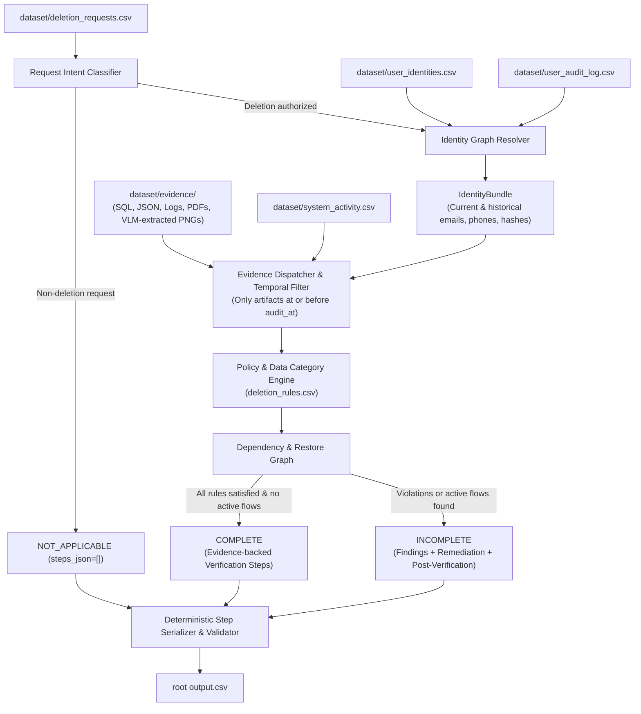

# Ghost Data Still Exists: AI Deletion-Audit Agent

[](https://wwww.hackerrank.com/contests/hackerrank-orchestrate-october26/challenges/ghost-data-still-exists)
[](https://www.python.org/)

An automated, evidence-grounded AI deletion audit system built for the **HackerRank Orchestrate (October 2026)** benchmark challenge: **Ghost Data Still Exists**.

**Official Challenge and Submission Link:**
https://wwww.hackerrank.com/contests/hackerrank-orchestrate-october26/challenges/ghost-data-still-exists

---

## 1. Problem Overview

In modern distributed architectures, a deletion workflow may report a privacy request as **"Complete"** while personal data persists across secondary replicas, support attachments, object stores, search indexes, analytics cohorts, logs, and backups. Worse, active replication streams, data synchronization connectors, or database restores can resurrect deleted records as "ghosts."

This audit agent systematically inspects subject privacy requests, determines true request intent, resolves historical identity mutations, audits multi-modal evidence across distributed systems at point-in-time cutoffs (`audit_at`), applies governance rules (`dataset/deletion_rules.csv`), and emits an evidence-backed verification and remediation sequence.

---

## 2. Architecture & Design

The solution implements a **deterministic core with temporal and identity graph reasoning** paired with a **Multimodal Vision-Language Model (VLM)** ingestion pipeline to guarantee speed, auditability, reproducibility, and zero hallucinated operations.



### Core Pipeline Components

1. **Request Intent Classifier (`code/reasoning/request_classifier.py`)**:
   - Parses multilingual requests to distinguish true account/data deletion from subject access, information requests, billing copies, marketing opt-outs, or profile updates.
   - Non-deletion requests safely evaluate to `NOT_APPLICABLE` with `steps_json = []`.

2. **Identity Graph Resolver (`code/identity/resolver.py`)**:
   - Reconstructs complete identity histories (current snapshot + historical audit log mutations) for each subject valid strictly up to `audit_at`.
   - Enforces temporal cutoffs on identity snapshots and detects ambiguous/shared email mappings across users.

3. **Multi-Modal Evidence Dispatcher (`code/evidence/dispatcher.py`)**:
   - Indexes and normalizes 94 evidence artifacts across SQL snapshots, JSON data bundles, application logs, text handover notes, PDF attachments, and administrative console PNG screenshots.
   - **VLM Image Ingestion**: Extracts structured records across all 11 administrative console screenshots in `dataset/evidence/images/`, recovering live accounts, active data flows, analytics profiles, and backup restore entries.
   - Enforces temporal isolation: artifacts captured strictly after `audit_at` are ignored.
   - **Manifest Coverage**: 93 of 94 evidence files produce active grounded records (with only `evidence_90` being an empty database schema with zero data rows). **0 unsupported files**.

4. **Policy Engine (`code/reasoning/policy_engine.py`)**:
   - Evaluates records against `deletion_rules.csv` across 15 categories: `USER_PROFILE`, `SECONDARY_IDENTIFIER`, `SEARCH_INDEX_ENTRY`, `SUPPORT_MESSAGE`, `SUPPORT_ATTACHMENT`, `ANALYTICS_PROFILE`, `SECURITY_AUDIT_LOG`, `ACCOUNT_TOMBSTONE`, `DATA_FLOW`, `BACKUP_ARCHIVE`, etc.
   - Enforces proper treatment: `DELETE`, `REDACT`, `ANONYMIZE`, or `RETAIN`.
   - Handles unsupported categories explicitly and models active data flows and backup restore blocks.

5. **Dependency & Restore Graph (`code/reasoning/remediation_planner.py`)**:
   - Traces active synchronization connectors (`REPORT_ACTIVE_DATA_FLOW`) and restore paths (`REPORT_RESTORE_RISK`).
   - Sequences remediation safely: disables active flows and blocks restores before modifying records.

6. **Strict Serializer & Contract Validator (`code/output/validator.py`)**:
   - Formats outputs to exact challenge specification, validating step numbers (1..N), allowed operations, and canonical phase ordering.
   - Enforces evidence relevance: validates that every cited `evidence_id` exists, was captured before `audit_at`, and matches the claimed subject, system, and resource.

---

## 3. Directory Layout

```text
├── AGENTS.md                                # Official instructions and turn logging requirements
├── README.md                                # Project documentation and execution guide
├── log.txt                                  # Append-only session transcript (for submission)
├── output.csv                               # Generated benchmark predictions (518 cases)
├── code.zip                                 # Packaged submission archive
├── requirements.txt                         # Python dependencies
├── .env.example                             # Environment variable template
├── dataset/                                 # Challenge dataset and evidence files
│   ├── deletion_requests.csv                # 518 evaluation cases to predict
│   ├── sample_deletion_requests.csv         # 32 public sample cases
│   ├── sample_output.csv                    # Ground-truth sample answers
│   ├── user_identities.csv                  # Current user identities snapshot
│   ├── user_audit_log.csv                   # Historical identity change events
│   ├── system_activity.csv                  # System operations and data flows
│   ├── deletion_rules.csv                   # 15 data category governance rules
│   ├── evidence_files.csv                   # Manifest indexing 94 evidence files
│   └── evidence/                            # Databases, documents, images, logs, records
├── evaluation/                              # Submission evaluation and usage reports
│   ├── evaluation_report.md                 # Accuracy metrics, regression tests, custom cases
│   └── usage_report.md                      # Token usage and cost accounting
└── code/
    ├── main.py                              # Main execution entry point
    ├── models.py                            # Strongly-typed data models
    ├── identity/                            # Identity history & resolver engine
    │   └── resolver.py
    ├── evidence/                            # Multi-format parsers (SQL, JSON, logs, PDF, VLM)
    │   ├── dispatcher.py
    │   └── parse_pdf.py
    ├── reasoning/                           # Policy engine, decision engine, planner, classifier
    │   ├── decision_engine.py
    │   ├── policy_engine.py
    │   ├── remediation_planner.py
    │   └── request_classifier.py
    ├── output/                              # Serializer and schema contract validator
    │   ├── serializer.py
    │   └── validator.py
    ├── evaluation/                          # Benchmark evaluation runner
    │   └── evaluate.py
    └── tests/                               # Comprehensive unit and regression test suite
        ├── test_identity.py
        ├── test_policy.py
        ├── test_validator.py
        ├── test_evidence_ingestion.py
        ├── test_regression.py
        ├── test_samples.py
        ├── test_serialization.py
        └── test_ordering.py
```

---

## 4. Quick Start & Execution

### Prerequisites
- Python 3.10+ (Standard library modules `sqlite3`, `csv`, `json`, `pathlib`, `re`, `datetime`, `urllib` are utilized; zero external packages required for deterministic local execution).

### 1. Run Predictions on Full Dataset (518 Cases)
To run the deletion-audit pipeline and generate `output.csv` at the repository root:
```bash
python code/main.py
```
This reads `dataset/deletion_requests.csv` and outputs exactly 518 validated rows into `output.csv` in **~0.70 seconds**.

### 2. Run Sample Benchmark Evaluation
To evaluate pipeline predictions against the public sample ground truth (`dataset/sample_output.csv`):
```bash
python code/evaluation/evaluate.py
```
**Current Benchmark Accuracy:**
- **Status Accuracy:** **100.00% (32 / 32)**
- **Phase Accuracy:** **91.19%**
- **Evidence ID Accuracy:** **90.67%**
- **Operation Accuracy:** **79.79%**
- **Step F1 Score:** **69.31%**

### 3. Run Unit and Regression Test Suite
To execute the complete 29-test automated test suite:
```bash
python -m unittest discover -s code/tests
```
All 29 tests pass in **< 0.40 seconds**, covering temporal cutoffs, identity disambiguation, validator constraints, data flow remediation, policy handling, and multi-modal evidence extraction.

---

## 5. Benchmark Output Contract

The generated root `output.csv` conforms strictly to the challenge schema:

```text
case_id,deletion_status,steps_json
```

| Field | Allowed Values / Format | Description |
|---|---|---|
| `case_id` | `case_XX` (lexicographically sorted) | Unique identifier for each evaluated request. |
| `deletion_status` | `COMPLETE`, `INCOMPLETE`, `NOT_APPLICABLE` | Audit verdict at the `audit_at` cutoff. |
| `steps_json` | JSON Array of objects (or `[]` for `NOT_APPLICABLE`) | Ordered sequence of findings, remediation, and verification. |

### Step Schema
```json
{
  "step_no": 1,
  "phase": "FINDING",
  "system_id": "account_service",
  "resource_id": "account_5762",
  "operation": "REPORT_REMAINING_RECORD",
  "state": "PRESENT",
  "evidence_id": "evidence_04"
}
```

### Canonical Ordering Rules
1. **Phases**: `FINDING` &rarr; `REMEDIATION` &rarr; `VERIFICATION`.
2. **Operations**:
   - **Findings**: `REPORT_REMAINING_RECORD` &rarr; `REPORT_EXPOSED_PII` &rarr; `REPORT_ACTIVE_DATA_FLOW` &rarr; `REPORT_RESTORE_RISK`
   - **Remediation**: `integration_service:DISABLE_DATA_FLOW` &rarr; `backup_service:BLOCK_RESTORE` &rarr; `DELETE_RECORD` &rarr; `REDACT_RECORD` &rarr; `ANONYMIZE_RECORD`
   - **Verification**: `VERIFY_RECORD_ABSENT` &rarr; `VERIFY_RECORD_PRESENT` &rarr; `VERIFY_RECORD_REDACTED` &rarr; `VERIFY_RECORD_ANONYMIZED` &rarr; `VERIFY_DATA_FLOW_DISABLED` &rarr; `VERIFY_RESTORE_BLOCKED`
3. **Evidence Citations**:
   - Findings cite participant-visible evidence (`file_id`, `activity_id`, `audit_id`).
   - Remediation and future verification steps for incomplete cases use an empty `evidence_id: ""`.
   - Verification steps for complete cases cite the evidence proving compliant state at `audit_at`.

---

## 6. Packaging & Submission

As specified in the challenge instructions, the final submission contains:
1. `code.zip`: Runnable code, documentation, configuration, and evaluation reports (excluding `dataset/`, `.venv/`, and `__pycache__`).
2. `output.csv`: Complete prediction rows for all 518 cases at repository root.
3. `chat_transcript`: The root `log.txt` file generated during the session.
4. AI Interview: Architectural explanation.

### Build Submission Zip
To regenerate `code.zip` bundle:
```bash
python scratch/package_submission.py
```
This automatically packages `code/`, `evaluation/`, `README.md`, `requirements.txt`, and `.env.example` into a clean `code.zip` (~68 KB).
